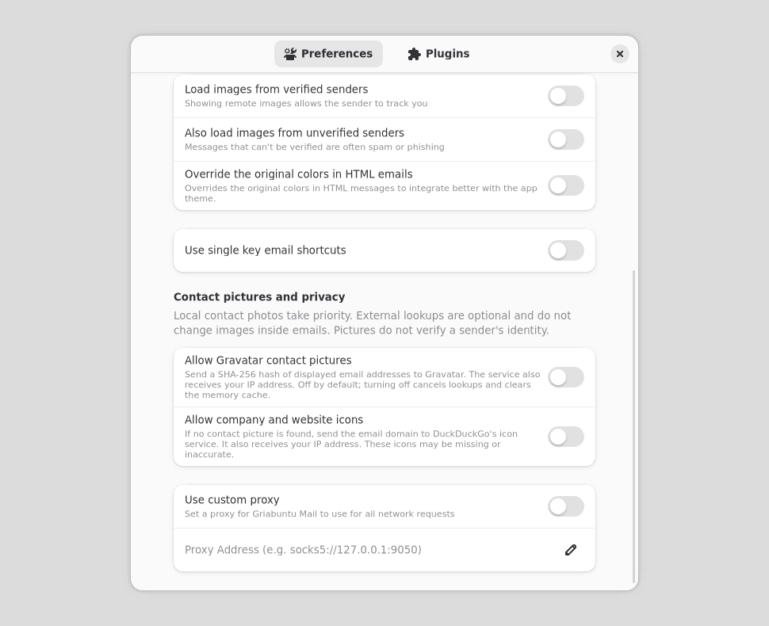

<div align="center">


# Ein ruhiger Platz für deine E-Mails.

**Griaß di Mail · native Linux-App · Ubuntu 26.10**

Pastelliges Petrol und warmes Pfirsich. Klare Unterhaltungen. Du entscheidest.

[English](README.md) · [Bauen](BUILDING.md) · [Datenschutz](docs/PRIVACY.md) · [Lizenzen](THIRD-PARTY-NOTICES.md)

</div>

## Für den Linux-Desktop

Griaß di Mail ist ein eigenständiger **Fork von Convey/Geary** mit GTK4 und
libadwaita. Native Menüs, Tastaturbedienung und Desktop-Integration bleiben
erhalten. Petrol/Teal und Kupfer/Pfirsich folgen dem Hell-, Dunkel- und
Hochkontrastmodus des Systems.

Entwicklung und Pflege: **Markus Kainer ·
[D3rPaPaH0d3n](https://github.com/D3rPaPaH0d3n)**. Kontakt:
**[projekt@kainer.co.at](mailto:projekt@kainer.co.at)** oder
[GitHub Issues](https://github.com/D3rPaPaH0d3n/griass-di-mail/issues).

## Die wichtigen Details im Blick

- **Kontaktbilder:** lokales Foto → freigegebenes Gravatar-Bild → zusätzlich
  freigegebenes Website-/Firmensymbol → Initialen.
- **Empfänger-Aliase:** erkennen, welche eigenen Adressen in To/Cc stehen.
- **Genaue Empfangszeit:** IMAP-Empfangsdatum mit Sekunden und Zeitzonendetails.
- **Tray für neue Nachrichten:** neue, ungesehene Mails dieser Sitzung, ohne
  doppelte Zählung über Konten und Ordner.
- **Anhänge:** TNEF-/winmail.dat-Unterstützung bleibt erhalten.
- **Native `.deb`:** gebaut gegen die Bibliotheken von Ubuntu 26.10.

Externe Kontaktbilder sind **standardmäßig aus**. Getrennte Schalter erläutern
die Übermittlung an Gravatar und DuckDuckGo. Mailinhalte werden für diese Abrufe
nicht übertragen. Die Bilder bestätigen keine Identität; Bilder im Mailtext
behalten ihre bisherigen Freigaben. [Datenschutz im Detail](docs/PRIVACY.md).

Der Tray zählt neue Nachrichten seit dem App-Start, nicht alle alten ungelesenen
Mails. Antworten öffnet einen Entwurf, ohne automatisch zu senden. Archivieren
und Löschen betreffen eine einzelne Nachricht; Löschen verwendet den Papierkorb.
Desktop-Benachrichtigungen hängen auch von der Desktop-Shell ab.

<details>
<summary>Datenschutzeinstellungen für Kontaktbilder ansehen</summary>



*Native Einstellungsvorlage mit synthetischem Zustand, ohne echte Konten.*

</details>

## Bauen und aktualisieren

Zielsystem: **Ubuntu 26.10, amd64**. Auf dem aktuellen Entwicklungsbranch:

```sh
sudo apt-get build-dep .
DEB_BUILD_OPTIONS=parallel=6 dpkg-buildpackage -b -us -uc
```

Die App beenden und die geschlossenen Daten sichern. Das geprüfte Paket dann
mit `sudo apt install ./griabuntu-mail_<version>_amd64.deb` installieren.
Die App nicht als root starten. Die Installation öffnet keine Konten.
Paketname, App-ID und Griabuntu-Mail-Profilpfade bleiben stabil. Ein Umzug von
Convey, Geary oder Flatpak ist ein gesonderter Vorgang.

[Bauanleitung](BUILDING.md) · [Paketierung](debian/README) ·
[Update und Datenerhalt](docs/UPGRADING.md) · [Prüfergebnisse](docs/VALIDATION-20261027.md)

Dies ist eine Entwicklungsvorschau. Vor einer Binärveröffentlichung sind
[Veröffentlichungsanforderungen](RELEASE-CHECKLIST.md) und die Bereitstellung
des zugehörigen Quellcodes zu beachten.

## Eigener Auftritt, erhaltene Herkunft

Griaß di Mail ist kein offizielles Produkt von Convey, Geary, GNOME oder
Canonical. Die Anwendung steht unter **GPL-3.0-only**; Bibliotheken, Symbole,
Klänge und eingebundene Komponenten behalten ihre jeweiligen Lizenzen.
Ursprüngliche Urheber, Hinweise und die Fork-Historie bleiben erhalten.

Der geschlossene Umschlag und das Banner wurden laut Bestätigung von Markus
Kainer mit ChatGPT allein aus Textbeschreibungen erzeugt.
[Grafikherkunft](docs/ARTWORK-PROVENANCE.md) · [Urheber](AUTHORS) ·
[Lizenzhinweise](THIRD-PARTY-NOTICES.md) · [Namensprüfung](docs/BRANDING.md).

## Mitmachen

Fehlerberichte, Übersetzungen und überschaubare Verbesserungen sind willkommen.
App- und Ubuntu-Version nennen und ausschließlich synthetische Beispiele verwenden.
Keine Zugangsdaten, persönlichen Mailtexte oder Maildatenbanken veröffentlichen.
Für sensible Meldungen gilt [SECURITY.md](SECURITY.md).
[Beitragen](CONTRIBUTING.md) · [Hinweise für Coding-Agenten](AGENTS.md)

---
Die ursprünglichen README-Urheberhinweise stehen vollständig in [README.md](README.md).
Änderungen © 2026 Markus Kainer <projekt@kainer.co.at>

Current name / Aktueller Name: **Griaß di Mail** (2026-10-28).
The native package remains `griabuntu-mail` for existing-profile upgrades;
der technische Paketname bleibt für Updates erhalten. The app remains free;
a voluntary donation button may be considered in future.
