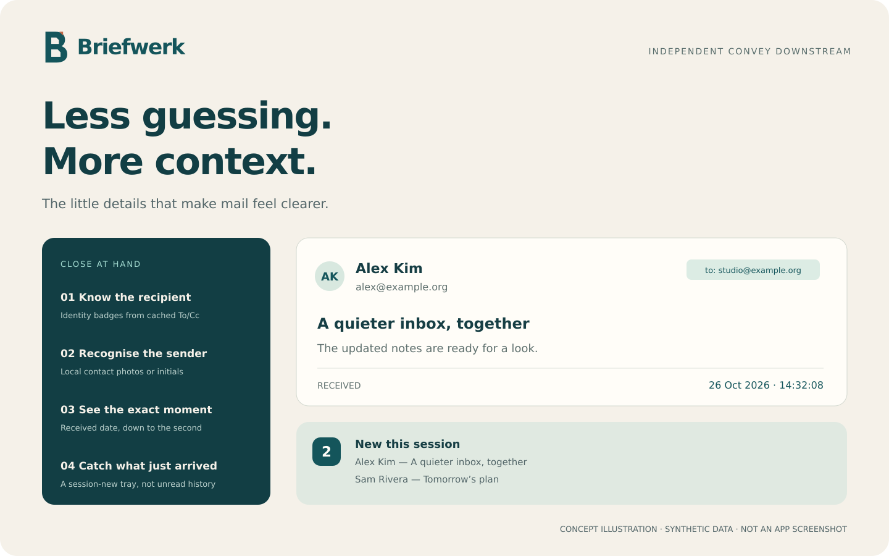

<!-- Downstream modification: 2026-10-26 — independent preparation README; original notices retained below. -->

# Briefwerk

A little more clarity in your inbox.

**Independent Convey downstream · Linux desktop mail**

Conversation-based email for the Linux desktop, with useful details close at hand.

[Features](#features) · [Build](BUILDING.md) · [Development status](#development-status) · [Licences](THIRD-PARTY-NOTICES.md)

*Concept illustration, not an application screenshot. All names and mail are synthetic.*

> **Development preview — no downstream public release yet.** Briefwerk is the chosen name; trademark review and a separate application ID are still pending. This branch prepares source and documentation; it is not a release, a support promise or a claim of completed licence compliance.

## ✨ Small details that matter

Built on [Convey](https://github.com/donnybeelo/convey), itself a fork of [Geary](https://gitlab.gnome.org/GNOME/geary), this independent downstream explores a more informative conversation list and lightweight desktop integration.

| Feature | What this snapshot does | Scope / caveat |
| --- | --- | --- |
| Recipient-alias badges | Up to two identity matches, then an overflow indicator | Matches cached To/Cc against configured identities; not proof of SMTP delivery |
| Local contact photos | Uses existing desktop contact photos, or initials | No new external avatar or logo service; sandbox needs read-only addressbook-cache access |
| Full sender details | Participant name and address, with literal-text tooltips | No shortened-address identity assurance |
| Exact received time | Absolute date and time including seconds | IMAP INTERNALDATE in the desktop timezone; tooltip includes zone/UTC offset |
| Native new-mail tray | Session-new/unseen count; up to five clickable sender/subject entries | Starts empty after restart; **not** historical unread count; needs a compatible StatusNotifierItem host |
| Individual popup actions 🧪 | Reply opens a composer; Archive/Delete move the exact message | Work in progress; desktop/composer acceptance still pending |

Popup Reply never sends automatically. Archive uses an existing All Mail/archive folder; Delete uses existing Trash. There is no expunge/permanent-delete fallback and no automatic destination-folder creation. Targets bind account, message and original folder; stale targets are rejected and concurrent repeated clicks are deduplicated. Group notifications remain Open-only. See [the engineering notes](CUSTOMIZATIONS.md).

## 🛠 Try the source, not the upstream download

There is **no published installer for this downstream**. Flathub's `net.donnybeelo.Convey` and the upstream author's repository install upstream Convey, not these modifications.

- Start with [BUILDING.md](BUILDING.md) for native development and the pinned local Flatpak practice manifest.
- Use synthetic accounts/data for first-run testing. Do not point an experimental build at an important existing profile.
- The inherited application IDs still overlap upstream. **Do not install this as a separate public app** until the [identity and migration plan](docs/BRANDING.md) is approved.
- GNOME SDK 51 is the current practice environment; a final distribution needs exact runtime/SDK commit recording and a clean source-to-binary mapping.

## 🚧 Development status

The notification-actions engineering snapshot was reported to pass **327 engine cases + 62 focused cases**, in development and release builds and against the staged release client library. Those are engineering results, **not a fresh test run or release certification of this preparation branch**. Tests use synthetic mail; no real-mail acceptance was performed.

Known gates:

- The separate notification-flag suite is deliberately **4/10 red** on the captured baseline: starring still-unread mail can retire tray entries. The production handler is unchanged; its fix is not part of this preparation.
- Visible popup buttons, opening the actual reply composer and end-to-end desktop mail moves still need explicit acceptance testing.
- Shell support affects tray and notification actions; not all desktops expose every action.
- Identity, dependency licensing, package contents and corresponding source remain release blockers. In particular, the pinned `libytnef` library has GPL-2.0-or-later file headers; the combined-binary implications must be resolved before distribution.

[Release checklist →](RELEASE-CHECKLIST.md) · [Test instructions →](test/README.md)

## 🤝 Contribute carefully

Please use this repository for downstream bugs and proposals, not upstream's tracker for unverified fork-specific issues. Keep examples synthetic; never attach mail stores, credentials, contact caches or unredacted debug logs. Read [CONTRIBUTING.md](CONTRIBUTING.md) and [SECURITY.md](SECURITY.md) first. No managed security-response SLA is offered.

[Original logo files and provenance →](brand/README.md) · [Name collision and identity plan →](docs/BRANDING.md)

## 📜 Standing on good work

This is an independent modification, **not official Convey or Geary**, and is not affiliated with or endorsed by their maintainers or the GNOME Foundation. Original authors, copyright notices and full upstream history are retained; see [AUTHORS](AUTHORS), [THANKS](THANKS) and [CUSTOMIZATIONS.md](CUSTOMIZATIONS.md).

Application source is declared **LGPL-2.1-or-later** in [COPYING](COPYING); AppStream metadata declares CC0-1.0. Icons, sounds and bundled libraries have their own terms. [THIRD-PARTY-NOTICES.md](THIRD-PARTY-NOTICES.md) explains the prepared notices and unresolved checks. No blanket relicensing is intended. The new illustration is original CC0-1.0 artwork; [provenance and licence](docs/images/README.md).

Deutsch, kurz

Ein unabhängiger Convey-Ableger mit Empfänger-Alias-Badges, lokalen Kontaktfotos, vollständigen Absenderdaten, sekundengenauer Empfangszeit und einem Tray für neue Nachrichten dieser Sitzung. Popup-Aktionen sind noch in Erprobung. Der Name **Briefwerk** ist gewählt; Markenprüfung, eigene App-ID und öffentliche Veröffentlichung stehen noch aus. Es gibt noch keinen öffentlichen Download dieses Ablegers; bekannte Fehler und Lizenzprüfungen stehen in der Release-Checkliste.

---
Original README notices retained:

Copyright © 2016 Software Freedom Conservancy Inc.
Copyright © 2017–2020 Michael Gratton <mike@vee.net>
Copyright © 2026 Daniel Elia <d.elia@outlook.com>
