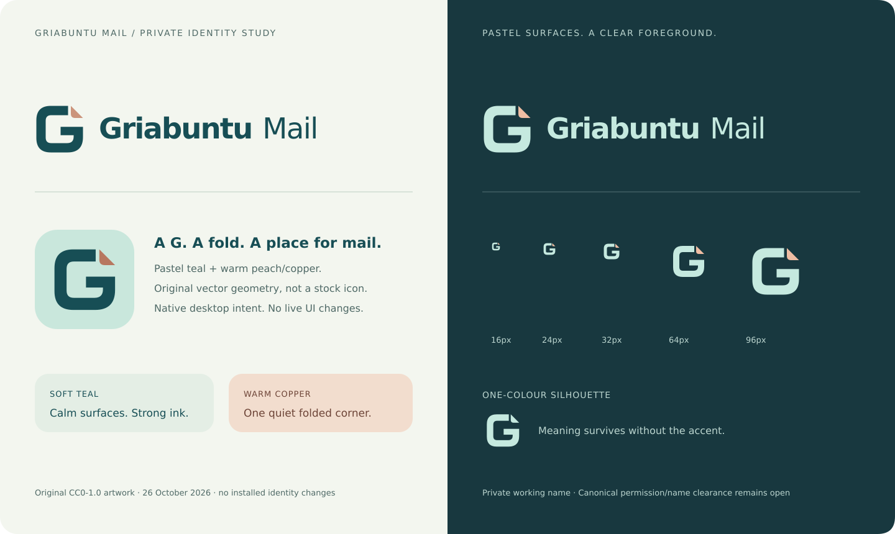

# Griabuntu Mail identity · 26 October 2026

Original artwork for Markus's chosen **private working name**, replacing the
superseded Briefwerk B-study (preserved in Git history). A newly drawn **G**
combines a folded-page silhouette, mail-slot crossbar and peach/copper corner.
No stock icon, external image service, Convey/Geary/GNOME/Ubuntu/Canonical logo
or borrowed brand artwork was used. These are candidates, **not installed icons**.

## Editable sources and exports

- `griabuntu-mail-symbol-{light,dark,mono}.svg` + transparent PNG: 128px symbols.
- `griabuntu-mail-wordmark-{light,dark,mono}.svg` + transparent PNG: 840×128 lockups.
- `griabuntu-mail-app-icon.svg`: pastel teal tile, deep petrol G, copper fold.
  PNG exports: **16, 24, 32, 64, 128, 256, 512px**; no install rules added.
- `identity-board.svg` + PNG: 1440×860 light/dark/mono and exact 16–96px studies.
- [Synthetic feature hero](../docs/images/inbox-details.svg) + 1440×960 PNG.

## Tonal design, native intent

Deep petrol `#174e55`, pastel teal `#c9e7dc`, soft teal `#e4eee5`, warm paper
`#f3f6ef`, peach `#f2ddce` and muted copper `#cb947b`; icon accent `#b77860`.
Dark-surface foreground uses pale teal `#c5e9df` and peach `#efbda3`.
Dark text anchors light surfaces; the copper fold is not body text or the only
source of meaning. Mono uses a single colour and transparency.

Keep clear space of at least one stem width. At 16px preserve the G opening and
crossbar; the tiny fold may simplify. The symbol is an original folded-page G,
not an envelope clipart outline or a circular Ubuntu-style motif.

Pastel/Material-inspired surfaces are a **future visual direction**, while actual
controls should remain native GTK4/libadwaita and respect Ubuntu/GNOME behaviour,
system theme, scaling and accessibility. This task does not redesign the running
app; see [desktop direction](../docs/desktop-design-direction.md).

## Provenance and rights

The **new SVG artwork and PNG renders in this directory**, and
`docs/images/inbox-details.{svg,png}`, are dedicated under **CC0-1.0** to the extent
copyright/related rights exist. [Full text](../docs/licenses/CC0-1.0.txt). This grant
covers neither inherited assets/code nor third-party trademarks. No warranty or
trademark clearance is asserted.

Vectors use new geometric paths/basic shapes. Wordmark/labels use system
**DejaVu Sans**, rendered locally with the system GdkPixbuf SVG loader; no font
files are bundled. Editable text may vary with fallback fonts; PNG previews fix
the intended appearance. No image-generation model was used. All hero names,
example.org addresses, subjects, counts and times are synthetic.

Actual renders and 16/24/32px exports were inspected. Six representative text/
tonal-surface pairs measure **5.43–8.07:1** contrast; this is an artwork check, not
acceptance of actual UI controls. Public-name clearance remains
open, especially Canonical's similar-BUNTU/software-title policy; an independence
disclaimer alone is insufficient. See [name findings](../docs/BRANDING.md) and
[unsent permission draft](../docs/CANONICAL-NAME-PERMISSION-DRAFT.md). No permission
was sought or obtained by this preparation, and no public release is authorised.
