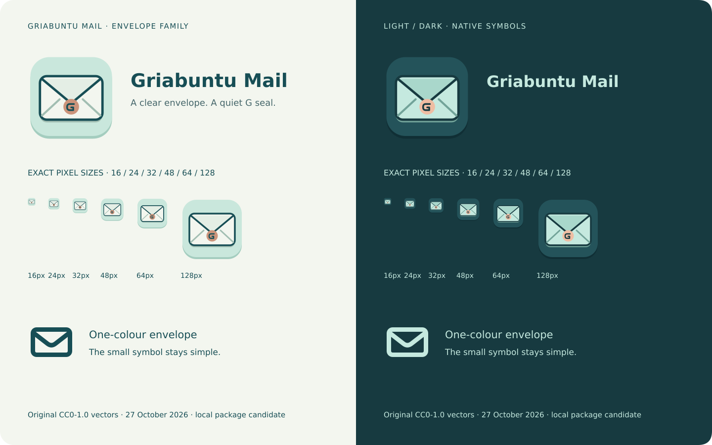

# Griabuntu Mail envelope icon family · 27 October 2026

The owner requested the new icons and symbols in the candidate package before
starting it on the system. The current implementation uses a clearly closed
**envelope**, with a small G seal as a secondary detail. Pastel teal/petrol and
copper/peach follow the established colour direction. This is a reviewable
package candidate, not an inferred final production-logo approval.



## Active editable sources

- `griabuntu-mail-app-icon.svg`: light pastel tile, paper envelope, petrol edges
  and a copper G seal. Exact PNG exports: **16, 24, 32, 48, 64, 128, 256, 512px**.
- `griabuntu-mail-app-icon-nightly.svg`: dark-toned variant of the same geometry,
  with the same PNG export sizes; selected by the existing nightly build option.
- `griabuntu-mail-tray.svg`: a simple 24px coloured tile/envelope. Its solid
  pastel backing keeps the dark envelope visible on both light and dark panels.
- `griabuntu-mail-symbolic.svg`: a reduced 16px single-colour envelope for GTK's
  theme-aware symbolic icon lookup. The small symbol omits the seal to retain
  clarity. Toolbar action icons continue to use the native GTK/system style.
- `griabuntu-mail-symbol-{light,dark,mono}.svg` and PNG: larger symbol exports.
- `griabuntu-mail-wordmark-{light,dark,mono}.svg` and PNG: corresponding lockups.
- `identity-board.svg` and PNG: actual 16–128px studies on light/dark surfaces.

`icons/meson.build` installs directly from these canonical brand sources using
the current application ID. It installs the SVG plus all native raster sizes,
the tray and symbolic variants, and the artwork notice. Development/beta app
IDs receive the same family; nightly selects the dark source. The help image is
an exact copy of the current app SVG. No old Convey artwork is selected by these
runtime install rules.

Regenerate exports with:

```sh
/usr/bin/python3 build-aux/render-brand.py
```

This uses the local GdkPixbuf/librsvg renderer. `build-aux/check-identity.py`
checks the self-contained SVGs, declared licence, export dimensions and help
copy. Package lookup and rendered application checks are separate validation.

## Preserved earlier work

The folded-page G study is preserved in `history/folded-g-20261026/`, including
its original sources, exports, board and provenance text. Earlier inherited
app/icon aliases are retained under `icons/historical/convey-before-envelope/`
with their original notices. These are history, not active install inputs.
The synthetic feature hero in `docs/images/` remains an earlier UI concept;
it is not a screenshot or acceptance evidence for the new package.

## Provenance and rights

The new 2026-10-27 envelope SVGs and their generated PNG exports are original
geometric artwork created locally with Codex assistance and dedicated under
**CC0-1.0** to the extent such rights exist. Full text: [COPYING](COPYING).
No raster generation model, stock image, borrowed logo, remote service or
bundled font is used by the runtime icons. Wordmark/board text uses the system
DejaVu Sans renderer; font files are not bundled. The previous CC0 dedication
for the archived folded-G study remains intact. No third-party asset is
relicensed by this grant, and no trademark rights are granted.

Palette: deep petrol `#174e55`, pastel teal `#c9e7dc`, paper `#f3f6ef`, soft teal
`#e4eee5`, copper `#cb947b`; dark variant uses `#24535a`, `#c5e9df` and `#efbda3`.
This icon work does not implement the future GTK control/theme redesign.
